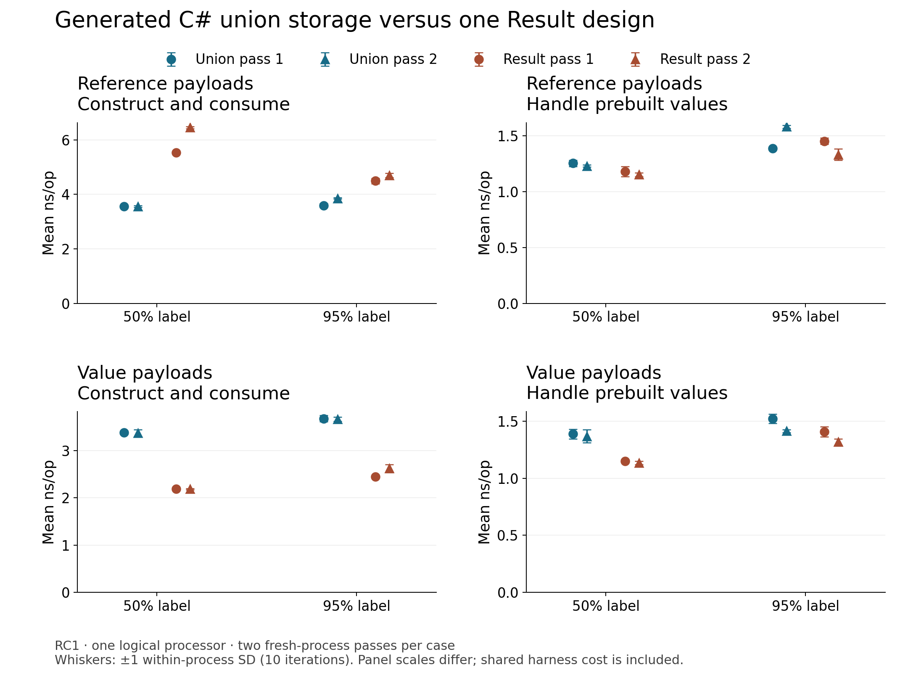
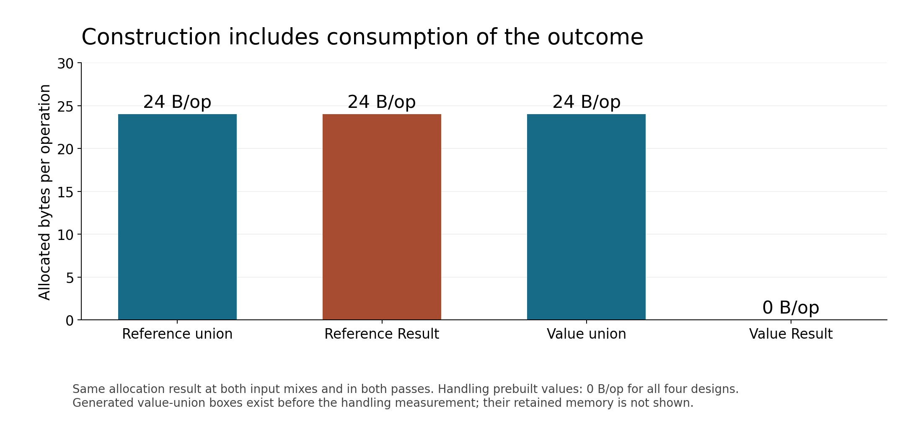

# Generated union versus explicit Result: RC1 results

[Complete concise dataset](results/summary.csv) retains all 32 case/process rows.
Times are nanoseconds per operation; allocation is managed bytes per operation.
The two passes are separate observations, with fully reversed case order in pass 2.
Each of 16 cases per pass runs in a fresh process. N=10 denotes measured iterations
within that process, not ten independent processes. Error bars show within-process
sample SD; there is no pooled confidence interval.

## What was observed

The synthetic climbing-course workload uses 1024 inputs with 512 or 972 accepted
outcomes (the latter is the nominal 95% mix). Construction includes consumption;
handling uses prebuilt outcomes. Eight methods compare generated C# 15 reference
and value unions with two explicit readonly Result layouts.

Reference union and ReferenceResult construction both allocate 24 B/op.
ValueUnion construction allocates 24 B/op, while ValueResult allocates 0 B/op.
All four handling methods allocate 0 B/op. Prebuilt value-union boxes are outside
handling timing: zero allocation there does not imply zero retained boxes.
Managed struct sizes are separately 8/24/8/12 bytes for reference union, reference
Result, value union and value Result; they are not total retained-object sizes.

A descriptive screen requires the same direction in both passes, a relative gap
of at least 5%, an absolute gap above twice the sum of the two SDs in each pass,
and no warmup/drift flag. Reference construction favors union in both mixes;
value construction favors Result in both mixes; value handling at 50% favors
Result. Reference handling in both mixes and value handling at 95% are inconclusive.
This screen is a reading aid, not significance testing or causal evidence.
No case triggered the descriptive stability flag, which cannot exclude tiering
or outside interference. Between-process variation exceeds within-host SD:
ReferenceResult construction at 50% is about 5.53 versus 6.45 ns, and reference
handling at 95% reverses direction between passes. Screened directions must not
be treated as stable effects or a universal winner.

## Reproduction and provenance

Use the [exact build, semantic and per-case commands](README.md). SDK
11.0.100-rc.1.26425.128 and runtime 11.0.0-rc.1.26425.128 are pinned; C# 15 uses
preview language mode and BenchmarkDotNet 0.16.0-preview.1. Workstation/concurrent
GC, tiered compilation, TieredPGO and ReadyToRun are enabled. The InProcessEmit
job uses five warmups, ten measured iterations, 200 ms target time, adaptive pilot
counts, UnrollFactor 1 and 1024 operations per invocation, without outlier removal.
The host and job pin logical processor 0 (affinity mask 1).

Measured source content matches commit `1b33149d10aa415d4aa4e4b3f9ff921ad92b03a5`.
The measured optimized binary was built before that commit: its generated
AssemblyInformationalVersion retains older base `6ffdddc1b4821272f76421bb92eccee3f59e15e5`.
Independent source-content and normalized Git-blob comparisons establish the
source match; binary revision metadata does not identify the later commit.
The local named-pipe permission failure required replay with the exact installed
SDK compiler followed by successful incremental MSBuild and BDN weaving. The
final woven binary, rather than the intermediate direct compiler output, was
used unchanged for every measured host.

## Limits that affect interpretation

The host was Windows x64 with registry-reported AMD Ryzen 9 9950X3D and 32 logical
processors, on the Balanced power plan. Physical topology and a reserved SMT
sibling were not established. All runtime/JIT/GC threads share the one selected
logical processor. Startup priority was Normal and setup priority High.
Interrupt/DPC counters were unavailable; short process snapshots provide only
partial interference observations. The host was in a job; queried CPU-rate flags
were zero, but other/enclosing job caps, turbo, thermals and scheduling limits
remain unknown. Defender and scanning status were not recorded during measurement.

WMI CPU access and redirected SDK detection failed. Pinned-version reflection
sets BDN host CPU metadata to Unknown and SDK metadata unavailable before timing;
this unsupported metadata workaround does not change timed workload execution.
Independent launcher observations establish the SDK and registry CPU identity.
Timer frequency was 10 MHz, but timer kind was Unknown. NuGet vulnerability lookup
was unavailable (NU1900), so no successful vulnerability scan is claimed.

The planned structural JSON classifier probe was skipped despite documentation
support; no classifier behavior is inferred. Default/null unions remain possible;
the separate no-fallback fixture throws SwitchExpressionException. Missing cases
produce warnings unless explicitly promoted to errors. The object/string fixture
accepts string input and observes a broad object arm binding the wrapper
(`object:TextOutcome`), an apparent RC1 divergence from the captured specification
wording, without diagnosing a compiler bug. Timed handlers have explicit fallbacks.
See [compiler fixtures](fixtures/README.md) for reproducible diagnostic examples.

Shared loops, lookups, summation, NoInlining calls, return ABI, validation, layout,
locality, PGO and GC all contribute to timings. The separate JIT probe has a
different profile and cannot identify the exact measured tier or optimizer cause.
Other Result layouts and custom nonboxing unions are unmeasured. The response DTO
checks use pure adapters, with no actual HTTP endpoint. Results establish neither
request latency, throughput, multicore scaling, GA behavior nor production impact.
